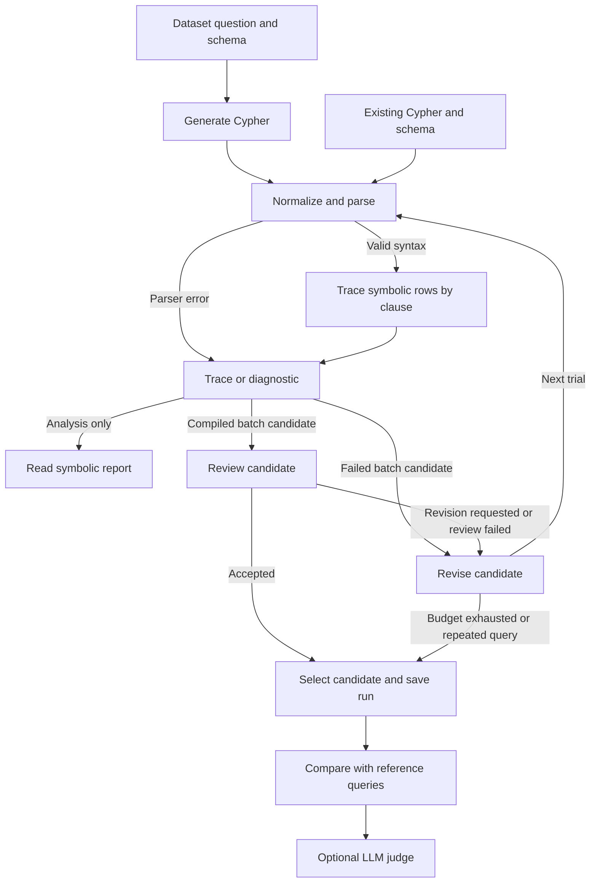

# CypherTrace

**Text-to-Cypher with schema-aware symbolic feedback.**

CypherTrace generates a read-only Neo4j query from a natural-language question and a graph schema. It parses each candidate and traces how its clauses change the rows, bindings, and multiplicities. A bounded revision loop uses parser errors, semantic diagnostics, and model feedback to improve the query.

The Python analyzer also runs on a query you already have. It can explain why a match might repeat a purchase before an average, or which variables a `WITH` drops from scope. It works from the schema and query without a Neo4j server or graph records.

## Pipeline at a glance



[Orchestration](src/pipeline/agent/orchestration.py) prefers the latest successfully compiled candidate when selecting the final query. A parser error goes straight to the generator as revision feedback when another trial is available. The checked-in experiment calls the critic with the question, schema, and candidate. The generator receives the symbolic trace or diagnostic on revisions, along with any critique.

## See the result

This [saved example](outputs/run-20261112T205017618408Z/query_0000/trial_1/query.cypher) asks for the average amount of purchases delivered to Montana.

```cypher
MATCH (p:Purchase)-[:DELIVERED_AT]->(a:DeliveryAddress)
WHERE a.state = 'Montana'
RETURN avg(p.amount) AS averagePurchaseAmount
```

| Stage | What the analyzer reports |
| --- | --- |
| `MATCH` | Each compatible purchase, delivery address, and relationship identity contributes a row. Multiple matching deliveries can repeat the same purchase. |
| `WHERE` | Only rows where the state comparison evaluates to true survive. False and null comparisons are discarded. |
| `RETURN` | `avg(p.amount)` uses surviving non-null amounts and weights them by row multiplicity. A purchase can contribute more than once if it has multiple matching deliveries. |

Read the [full symbolic trace](outputs/run-20261112T205017618408Z/query_0000/trial_1/report.txt) or the [saved batch evaluation](outputs/run-20261112T205017618408Z/evaluation.json).

## Run CypherTrace

Use **Python 3.11 or newer**. From the repository root in PowerShell:

```powershell
python -m venv .venv
.\.venv\Scripts\Activate.ps1
python -m pip install -e .
```

### Analyze a bundled query without a model

This example prints the symbolic trace for the first [bank account fixture](tests/fixtures/bank_account_trials.json).

```powershell
@'
import json
from pathlib import Path

from graph_query_analysis.input import parse_requests
from graph_query_analysis.report import generate_report
from pipeline.parser import build_request

records = json.loads(Path("tests/fixtures/bank_account_trials.json").read_text(encoding="utf-8"))
record = records[0]
request, = parse_requests(build_request(record["cypher"], record["schema"]))
print(generate_report(request).render())
'@ | python -X utf8 -
```

### Generate and revise queries for a dataset

Copy [`.env.example`](.env.example) to `.env` and fill in `OPENROUTER_API_KEY` and `OPENROUTER_MODEL`. For the `open_ai` service, use `OPENAI_API_KEY` and `OPENAI_MODEL`. This example uses two Mind-the-Query rows and skips the optional judge.

```powershell
python -m pip install -e ".[llm,datasets]"
Push-Location src/pipeline
@'
from config import get_config
from main import main

config = get_config("mtq_eval")
result = main(
    dataset_name=config["dataset_name"],
    split=config["split"],
    validation_type=config["validation_type"],
    limit=2,
    max_revisions=config["max_revisions"],
    agent_instructions=config["agent"],
    max_report_chars=config["max_report_chars"],
    llm_as_judge=False,
)
print(result["run_dir"])
'@ | python -X utf8 -
Pop-Location
```

The [script block in `main.py`](src/pipeline/main.py) currently runs the judge against a fixed saved experiment. Use the `main()` call above for a fresh generation run. The first dataset run may download data and schemas.

| Setting | Purpose |
| --- | --- |
| `dataset_name`, `split`, `validation_type` | Select Mind-the-Query (`mtq`) or CypherBench (`cypherbench`). Split and validation type select the Mind-the-Query subset. |
| `limit` or `indices` | Take the first *n* rows, use `"total"` for the full split, or pass specific dataset indices to `main()`. |
| `max_revisions` | Number of retries allowed after the first candidate. |
| `agent` | Provider, model, completion token limit, and optional OpenRouter reasoning effort for generation and review. A null model reads the provider's model environment variable. |
| `max_report_chars` | Character cap for the `model_report` field saved in trial history. The current revision call sends the compact trace before clipping. |
| `llm_as_judge` | Boolean argument to `main()` that enables a separate review of the saved final queries. |

## Find your results

Each batch creates a timestamped folder under [`outputs/`](outputs/).

| File | What it contains |
| --- | --- |
| `summary.json` | Selected query, trial, status, and stop reason for each dataset row. |
| `query_0000/history.json` | The question, recorded trials, reports, critiques, and errors. |
| `query_0000/trial_1/query.cypher` and `report.txt` | The candidate and its symbolic trace or diagnostic. |
| `evaluation.json` | Initial and final compile rates, normalized-text exact matches against dataset references, and recorded model token usage. |
| `schemas.json` | Schemas aligned with the evaluation cases for later judging. |
| `judge_results.json` and `analysis_judge_results.json` | Optional per-query judge verdicts, reference comparisons, and aggregate statistics. |

[The judge](src/pipeline/agent/llm_judge.py) can also review a saved run using its evaluation and schema files. Its verdicts are model assessments. Exact match measures normalized query text, so equivalent queries can score differently. Compile rate measures how many candidates the Python analyzer could handle.

## Project map

| Path | Purpose |
| --- | --- |
| [`src/`](src/) | Python source for the symbolic analyzer and dataset pipeline. |
| [`src/pipeline/`](src/pipeline/) | Run configuration, Cypher normalization and parsing, batch processing, and artifact writing. |
| [`src/pipeline/agent/`](src/pipeline/agent/) | Generator, critic, and judge clients, their prompts, and the bounded revision loop. |
| [`src/pipeline/data/`](src/pipeline/data/) | Mind-the-Query and CypherBench loaders and schema preprocessing. |
| [`src/graph_query_analysis/`](src/graph_query_analysis/) | Scope and type checks, symbolic row operators, multiplicity expressions, and operator-by-operator reports. |
| [`src/graph_query_analysis/reporting/`](src/graph_query_analysis/reporting/) | Supporting analysis and rendering modules for scope, grouping, filters, lineage, ordering, and schema evidence. |
| [`configs/`](configs/) | JSON presets for dataset selection, revision budgets, report settings, and model options. |
| [`outputs/`](outputs/) | Saved experiment runs, query histories, reports, schemas, and evaluation artifacts. |
| [`tests/`](tests/) | Python tests for symbolic semantics, schema conversion, pipeline behavior, and optional Neo4j conformance. |
| [`tests/fixtures/`](tests/fixtures/) | Local question, schema, and Cypher examples for offline analysis. |
| [`tests/legacy/`](tests/legacy/) | Archived tests and utilities for the earlier Lean bridge. |
| [`docs/`](docs/) | Python design notes, historical implementation progress, and AI use documentation. |
| [`.github/workflows/`](.github/workflows/) | GitHub Actions workflow for Python checks. |

## Analysis scope

The analyzer covers a subset of Cypher 25, including fixed-length mandatory `MATCH`, supported predicates, `WITH`, `RETURN`, `DISTINCT`, grouping, and common aggregates. Some order-sensitive operations have partial symbolic interpretations. `OPTIONAL MATCH`, variable-length paths, subqueries, and writes are outside the supported analysis fragment.

An observed schema describes the labels, relationships, and properties supplied to the analyzer. It gives no guarantee that a particular match exists or that a relationship is unique. The symbolic trace explains what the query would do over compatible graphs. See the [Python design notes](docs/python-plan.md) for the model and its limits.
