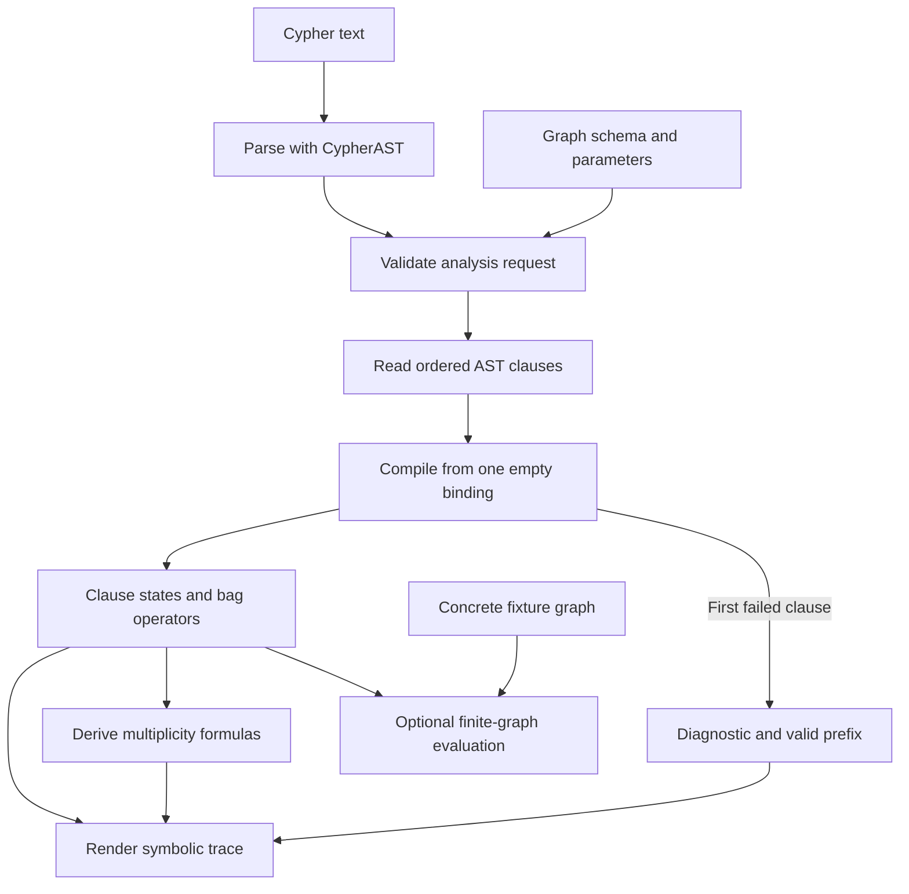

# Graph query analysis

This package explains how a supported Cypher query transforms rows using only the query and a supplied graph schema. It tracks variable scope, match witnesses, and row multiplicities, then renders those changes as a symbolic trace. The analysis can show how duplicate matches could affect a count or average even when the actual graph is unavailable.

[Back to CypherTrace](../../README.md) · [Bags](#why-bags-matter) · [Worked example](#counting-each-purchase-once) · [Module map](#module-map)

## Analysis pipeline



1. **Parse and validate.** The pipeline's [parser](../pipeline/parser.py) builds the Cypher abstract syntax tree (AST). [`input.py`](input.py) validates the request envelope and loads the schema. The analyzer takes clauses from the serialized `Cypher → Query → clauses` tree.
2. **Compile in clause order.** [`compiler.py`](compiler.py) starts with `UnitBag()`, an empty scope, and an empty pattern snapshot. It applies [`transform_clause()`](transforms.py) to each clause and stores the resulting state. Each new bag operator links to its input through `source`.
3. **Explain the operators.** [`algebraic_translation.py`](algebraic_translation.py) derives multiplicity expressions over possible bindings. [`report.py`](report.py) walks the operators added by each clause and prints their effects, formulas, schema evidence, and scope changes. If compilation stops, the report explains the successfully compiled prefix and identifies the failing clause.
4. **Evaluate on a fixture if needed.** [`evaluate.py`](evaluate.py) can interpret the same operator chain over a small concrete graph. This path exposes actual rows and their counts for a supplied fixture. The symbolic report requires no fixture.

### What a clause state carries

| Field | What it represents |
| --- | --- |
| `schema` | The supplied labels, property types, and directed relationship signatures. |
| `scope` | Visible Cypher names, the symbols they refer to, and their known types. A later clause resolves names against this scope. |
| `bag` | The cumulative expression for the rows at this point in the query. |
| `graph` | A NetworkX snapshot of symbolic pattern requirements. Its nodes and edges describe the pattern built so far. Actual row matching and multiplicity come from the bag operators. |

One clause can add several operators. An attached `WHERE` adds a filter after `MATCH`. A `WITH DISTINCT` projection adds a projection followed by deduplication. The compiler records states at **clause boundaries**, and the report numbers **individual operators** so intermediate effects remain visible.

## Why bags matter

A **bag** is a collection that retains duplicate rows. Its **multiplicity** is the number of occurrences of a particular row. If three input rows project to the same output tuple, that tuple has multiplicity three. A set would record only its presence.

The analyzer represents multiplicity symbolically as `μ(x)`, where `x` is a tuple of row bindings. The expression describes how many occurrences a tuple would have for a given graph. At the start, the empty tuple has multiplicity one. This gives the first `MATCH` a single input from which to extend bindings.

| Operator | Effect on the bag |
| --- | --- |
| `MatchBag` | Extends each input row with compatible node and relationship assignments. Distinct relationship identities can create multiple rows even when the same nodes are bound. |
| `FilterBag` | Keeps the original multiplicity when the predicate is true. False or null contributes zero. |
| `ExtendBag` | Computes aliases while keeping input bindings available to modifiers such as `WHERE`. A later projection removes the hidden bindings. |
| `ProjectBag` | Keeps the requested columns and sums the counts of input rows that produce the same output tuple. |
| `DistinctBag` | Sets each present tuple's multiplicity to one. Entity columns compare by node or relationship identity. |
| `AggregateBag` | Groups input rows and computes aggregates within each group. `COUNT(*)` includes every occurrence. `COUNT(expr)` counts non-null occurrences. `AVG(expr)` weights non-null values by their multiplicities. |
| `SortBag` and `SliceBag` | Sorting keeps row counts. `SKIP` and `LIMIT` select occurrences from a row stream, so the selected rows can depend on ordering and ties. |

## Counting each purchase once

```cypher
MATCH (p:Purchase)-[:DELIVERED_AT]->(a:DeliveryAddress)
WHERE a.state = 'Montana'
WITH DISTINCT p
RETURN count(*) AS purchases
```

The AST has three top-level clauses, `Match`, `With`, and `Return`. The compiler decomposes them into five operations. To see why the distinction matters, suppose one purchase `p1` has two separate delivery relationships to a Montana address and one to an Idaho address.

| Report stage | Clause | Operation | Example result |
| --- | --- | --- | --- |
| `S0` | Start | `UnitBag` | One empty binding. |
| `S1` | `MATCH` | `MatchBag` | Three matches, one per delivery relationship. The anonymous relationship has its own internal binding slot. |
| `S2` | `WHERE` attached to `MATCH` | `FilterBag` | Two matches survive the Montana filter. |
| `S3` | `WITH DISTINCT p` | `ProjectBag` | The two matches project to `(p1)` with multiplicity two. |
| `S4` | `WITH DISTINCT p` | `DistinctBag` | The tuple `(p1)` now has multiplicity one. Only `p` remains visible to the next clause. |
| `S5` | `RETURN count(*)` | `AggregateBag` | The single result row has `purchases = 1`. |

With `WITH p`, the projected purchase still has multiplicity two and the returned count is `2`. The result in either case is one aggregate row. Its **count value** measures input occurrences, while its **row multiplicity** describes how often the aggregate result row occurs.

The same distinction matters for averages. If each purchase should contribute once, deduplicate the purchase identity before `AVG(p.amount)`. `AVG(DISTINCT p.amount)` deduplicates amounts, so two purchases with the same amount contribute only one value between them.

### Run the symbolic trace

Run this Python example from the repository root after `python -m pip install -e .`. It prints the five operations and their formulas from the schema alone.

```python
from graph_query_analysis.input import parse_requests
from graph_query_analysis.report import generate_report
from pipeline.parser import build_request

query = """
MATCH (p:Purchase)-[:DELIVERED_AT]->(a:DeliveryAddress)
WHERE a.state = 'Montana'
WITH DISTINCT p
RETURN count(*) AS purchases
"""

schema = {
    "node_props": {
        "Purchase": [],
        "DeliveryAddress": [{"property": "state", "type": "STRING"}],
    },
    "rel_props": {},
    "relationships": [
        {"start": "Purchase", "type": "DELIVERED_AT", "end": "DeliveryAddress"},
    ],
}

request, = parse_requests(build_request(query, schema))
report = generate_report(request)
print(report.render())
```

The values `1` and `2` in the walkthrough come from the hypothetical fixture. The report above describes the operations and their formulas, so it can be generated before a graph is supplied.

## Module map

| Path | Purpose |
| --- | --- |
| [`input.py`](input.py), [`model.py`](model.py) | Validate the request and represent the schema, AST clauses, bindings, and symbolic states. |
| [`compiler.py`](compiler.py), [`transforms.py`](transforms.py) | Apply clauses in order. Translate pattern, predicate, projection, and aggregation syntax into bag operators and update scope. |
| [`expressions.py`](expressions.py), [`cypher_types.py`](cypher_types.py) | Define symbolic values, predicates, bag operators, and the type information used during compilation. |
| [`graph.py`](graph.py) | Represent schema signatures and maintain NetworkX snapshots of symbolic pattern requirements. |
| [`algebraic_translation.py`](algebraic_translation.py) | Interpret bag operators as expressions for row multiplicity, grouping, and aggregate values. |
| [`report.py`](report.py) | Produce the active trace, including the effect, formula, and schema evidence for each operator. |
| [`diagnostics.py`](diagnostics.py) | Find AST issues in batch compilation diagnostics, including issues that can be checked independently of an earlier failed clause. |
| [`evaluate.py`](evaluate.py) | Run a compiled bag on a concrete fixture graph and inspect rows, order, and counts. |
| [`reporting/`](reporting/) | Section-based analyses for patterns, scope, lineage, grouping, and other properties. The active operator trace is built in `report.py`. |

## Analysis limits

The compiler handles a read-only fragment centered on fixed-length mandatory `MATCH`, `WITH`, and `RETURN`, with supported filters, projections, grouping, and aggregates. Unsupported constructs such as `OPTIONAL MATCH`, variable-length paths, and subqueries stop compilation. A query can compile with a **partial** symbolic interpretation when an operation needs information that a bag alone cannot supply, such as which rows survive pagination or the order of a `collect()` result.

An observed schema supplies evidence about the graph's structure. A listed signature gives no guarantee that a matching relationship exists, and a missing signature may reflect incomplete observations. Use the trace to inspect query behavior and its assumptions. Correctness against a natural-language question depends on whether that behavior matches the intended result.
